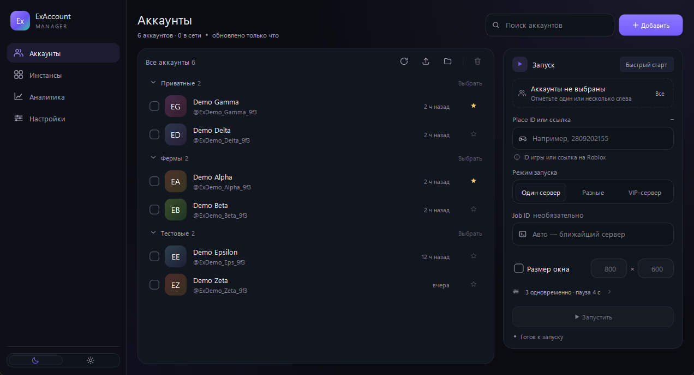
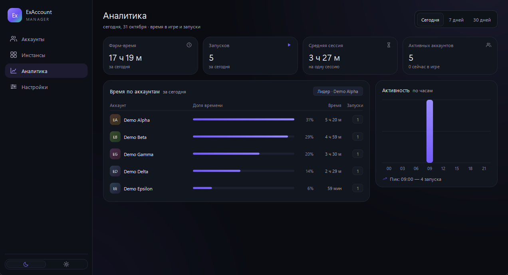
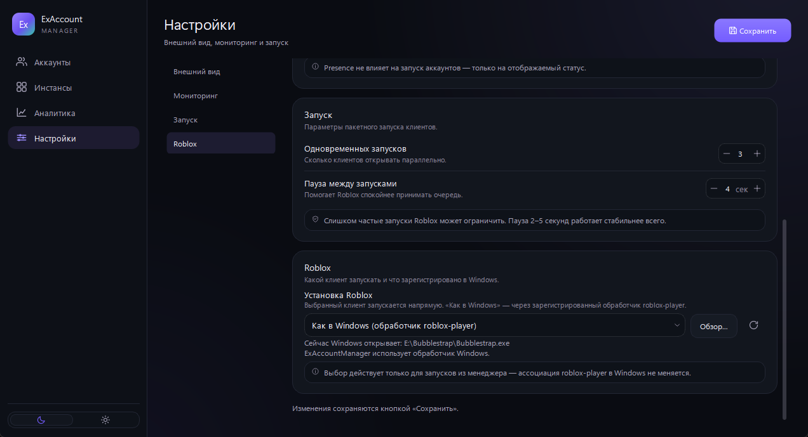
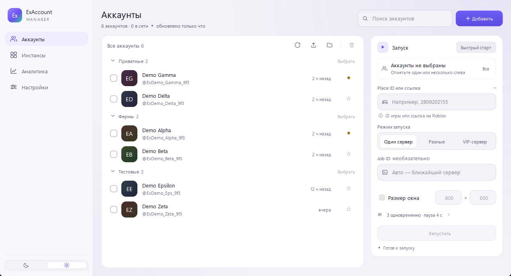
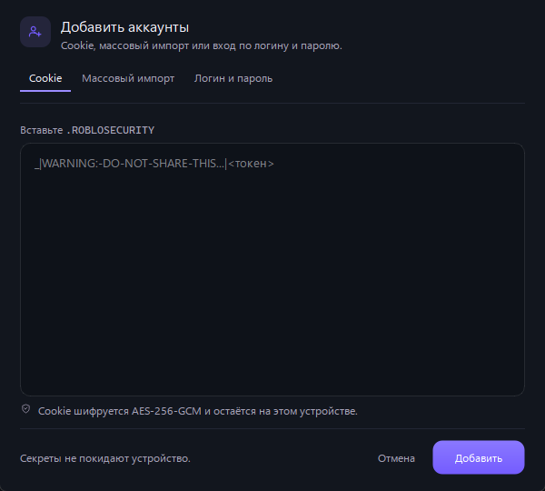

# ExAccountManager

[English version](README.en.md)

Менеджер мультиаккаунтов Roblox для Windows: лучшие наработки трёх менеджеров
(RAM / RM / Astro) в одном приложении — вход по cookie и через браузер, массовый
запуск на разные серверы и VIP, лимиты ОЗУ/CPU, произвольный размер окон,
атрибуция процессов и аналитика фарма. Интерфейс на русском.



## Возможности

| Блок | Что умеет |
| --- | --- |
| Аккаунты | cookie с валидацией до сохранения, bulk-импорт (`user:pass[:cookie]`, cookie, файл), группы, presence, аватары, ревалидация, бан-детектор |
| Вход через браузер | Edge/Chrome + CDP: автозаполнение формы, перехват HttpOnly `.ROBLOSECURITY`, пароль в vault для ре-логина, по 2 окна в сетке |
| Запуск | `roblox-player` URI, auth-ticket, CSRF, share-ссылки; режимы «один сервер / разные / VIP»; выбор конкретного `RobloxPlayerBeta.exe` вместо обработчика Windows |
| Инстансы | атрибуция PID→аккаунт (launchtime + чтение PEB), kill-verified, скрытие/фокус/сетка, принудительный размер окна, опция «Multi Roblox» (менеджер держит `ROBLOX_singletonMutex`) |
| Лимиты | жёсткий лимит рабочего набора (ОЗУ) без Job Object; CPU — Job Object, при отказе приоритет + EcoQoS |
| Аналитика | CPU/RAM по процессам, ledger сессий, время фарма за сегодня / 7 / 30 дней |
| Хранилище | SQLite + envelope AES-256-GCM (libsodium), ключ в Credential Manager или Argon2id от пароля, атомарные записи и самолечение vault |

## Экраны

| Аналитика | Настройки: клиент Roblox |
| --- | --- |
|  |  |

| Светлая тема | Добавление аккаунта |
| --- | --- |
|  |  |

## Сборка

Нужны Visual Studio 2022 (MSVC), CMake ≥ 3.24, Ninja и Qt 6.5+ (msvc2022_64).
Пути к VS/Qt зашиты в `scripts/env.bat` — поправь под свою машину.

```bat
scripts\env.bat
cmake --preset release
cmake --build --preset release
build\release\ExAccountManager.exe
```

- Тесты: `build\release\ex_tests.exe` — 15 тестов (крипто, bulk-парсер, URI, WS-кадры,
  store, ledger, лимиты, изоляция HTTP-cookie, поиск установок Roblox).
- Диагностика хранилища секретов: `build\release\vault_check.exe [пароль]`.
- Портативный режим: маркер-файл `portable` рядом с exe — данные в `data/`,
  иначе `%APPDATA%\ExAccountManager`.
- Для auth-ticket используется системный `curl.exe` (Schannel): Qt-клиент получает
  401 на CSRF-retry. Без curl работает Qt-fallback.

## Архитектура

```
src/core/      домен без Widgets: models, store (SQLite), crypto (envelope),
               roblox (API, bulk-импорт, CDP-вход), launcher (URI, очереди),
               instances (атрибуция PID), net (WebSocket), util (лог со скраббингом)
src/platform/  Win32: процессы (чтение PEB), окна, Job Objects, DPAPI/Credential Manager,
               мьютекс мультиинстанса, запуск с понижением прав
src/ui/        Qt Widgets: темы Material 3, nav rail, экраны, диалоги
tests/ tools/  15 тестов QtTest + vault_check
third_party/   sqlite3 (amalgamation), libsodium (prebuilt static)
```

## Принципы

1. Секреты не лежат открытым текстом и не попадают в логи: envelope-шифрование плюс
   скраббинг на уровне sink'а.
2. Все on-disk записи атомарны, есть бэкапы и самолечение vault.
3. Чужие процессы не убиваем: только после тройной верификации
   (имя образа + launchtime-токен + create_time).
4. Никакого инжекта в клиент Roblox — только внешние Win32-вызовы.
5. План ≠ действие: настройки запуска — данные, исполняет сервис.
